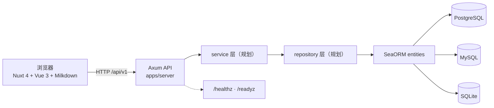

# TUSTOSC Knowledgebase

天津科技大学开放原子开源协会的**类语雀知识库**：空间、文档、版本、权限、协作，一套属于社团自己的知识沉淀平台。

[](https://github.com/Mike-Solar/tustosc-knowledgebase/actions/workflows/ci.yml)
[](LICENSE)

> **当前阶段**：后端骨架已完成（配置、数据库、迁移、错误模型、中间件、健康检查、7 张表的实体），业务接口正在按 [`docs/api.md`](docs/api.md) 的规划逐步实现。本文档会随代码同步更新。

## 项目目标

- **类语雀的核心闭环**：空间 → 目录 → 文档 → 历史版本，权限按空间粒度控制。
- **多人协作不丢数据**：乐观锁（`documents.revision`）+ 每次保存生成版本快照，冲突有明确提示。
- **对新人友好的工程样板**：目录边界清晰、中文注释、文档与代码同步，Rust 初学者也能参与。
- **本地零门槛**：Docker 一键起数据库，或直接用 SQLite 单文件运行。

## 功能概览

| 能力 | 状态 |
| --- | --- |
| 用户注册 / 登录 / TOTP 两步验证 / 刷新令牌轮换 | 数据表已实现，接口规划中 |
| 知识空间与成员角色（OWNER / ADMIN / EDITOR / VIEWER） | 数据表已实现，接口规划中 |
| 文档 CRUD、Markdown 编辑、乐观锁保存 | 数据表已实现，接口规划中 |
| 历史版本快照、查看、回滚 | 数据表已实现，接口规划中 |
| 回收站（软删除）、目录树 | 字段已预留 |
| 健康检查 `/healthz`、`/readyz` | ✅ 已实现 |
| 搜索、评论、实时协作、附件 | 规划中（P1 / P2） |

完整能力矩阵与演进路线见 [`docs/architecture.md`](docs/architecture.md)。

## 架构总览



- 前端 `apps/web`：Nuxt 4 渲染层 + Clean Architecture 四层业务内核，Markdown 编辑器使用 Milkdown。
- 后端 `apps/server`：Axum HTTP 层 + SeaORM 数据访问，统一错误模型与中间件。
- 迁移 `crates/migration`：SeaORM 迁移，7 张表，独立二进制执行。
- 同一份后端代码通过 `DATABASE_URL` 支持 PostgreSQL / MySQL / SQLite。

## 技术栈

| 领域 | 技术 | 版本 |
| --- | --- | --- |
| 语言（后端） | Rust（edition 2024） | stable |
| Web 框架 | [Axum](https://github.com/tokio-rs/axum) | 0.8 |
| ORM / 迁移 | [SeaORM](https://www.sea-ql.org/SeaORM/) / sea-orm-migration | 2.0 |
| 异步运行时 | Tokio | 1.x |
| HTTP 中间件 | tower-http（CORS / Trace / RequestId / Timeout） | 0.6 |
| 数据库 | PostgreSQL 17 / MySQL 8.4 / SQLite | — |
| 前端框架 | [Nuxt](https://nuxt.com) 4 + Vue 3 | 4.4 / 3.5 |
| Markdown 编辑器 | [Milkdown](https://milkdown.dev) | 7.22 |
| 语言（前端） | TypeScript | 6.0 |
| UI | Nuxt UI 4 + Tailwind CSS 4 + Pinia | — |
| 包管理（前端） | pnpm workspace | ≥ 11 |
| Node.js | — | ≥ 22 |
| 测试 | cargo test / Vitest | — |
| Lint | rustfmt / clippy / ESLint / Prettier | — |
| 许可证 | AGPL-3.0 | — |

## 目录结构

```text
tustosc-knowledgebase/
├── apps/
│   ├── server/                 # Rust 后端（knowledgebase-server）
│   │   └── src/
│   │       ├── main.rs         # 入口：加载 .env → 配置 → run()
│   │       ├── lib.rs          # 启动流程与优雅停机
│   │       ├── app.rs          # 路由装配 + 中间件
│   │       ├── config.rs       # 环境变量 → AppConfig
│   │       ├── db.rs           # 连接池与迁移
│   │       ├── error.rs        # AppError 统一错误模型
│   │       ├── state.rs        # AppState
│   │       ├── telemetry.rs    # tracing 初始化
│   │       ├── routes/         # HTTP 入口（health 已实现）
│   │       └── entities/       # SeaORM 实体（7 张表）
│   └── web/                    # Nuxt 4 前端（knowledgebase-web）
│       ├── app/                # 页面、组件、布局、composable
│       ├── domain/ · application/ · interface-adapters/ · infrastructure/
│       ├── server/ · shared/   # Nuxt 服务端与跨端代码
│       └── docs/               # 前端架构、指南与 ADR
├── crates/
│   └── migration/              # SeaORM 迁移（knowledgebase-migration）
├── docs/                       # 全项目文档
│   ├── architecture.md         # 架构设计
│   ├── api.md                  # API 规范
│   ├── development.md          # 开发指南
│   └── adr/                    # 架构决策记录
├── Cargo.toml                  # Rust virtual workspace
├── package.json                # pnpm workspace 根
├── pnpm-workspace.yaml
├── docker-compose.yml          # 本地数据库（postgres / mysql profile）
├── .env.example                # 环境变量模板
├── CONTRIBUTING.md             # 贡献指南
└── LICENSE                     # AGPL-3.0
```

## 快速开始

### 前置工具链

| 工具 | 版本 | 检查 |
| --- | --- | --- |
| Rust | stable（≥ 1.85，edition 2024） | `rustc --version` |
| Node.js | ≥ 22 | `node --version` |
| pnpm | ≥ 11 | `pnpm --version` |
| Docker | 任意较新版本 | `docker --version` |

### 1. 启动数据库

```bash
docker compose up -d
```

默认启动 PostgreSQL：端口 `5432`，数据库 / 用户 / 密码均为 `knowledgebase`。

```bash
# 可选：同时启动 MySQL（端口 3306）
docker compose --profile mysql up -d
```

不想用 Docker？SQLite 零依赖：把 `.env` 中的 `DATABASE_URL` 改为 `sqlite://knowledgebase.db?mode=rwc` 即可。

### 2. 启动后端

```bash
cp .env.example .env
cargo run -p knowledgebase-server
```

启动成功后可验证健康检查：

```bash
curl -s http://127.0.0.1:8080/healthz
# {"status":"ok","service":"knowledgebase-server","version":"0.1.0"}

curl -s http://127.0.0.1:8080/readyz
# {"status":"ready","database":"up"}
```

### 3. 启动前端

```bash
pnpm install
pnpm --filter knowledgebase-web dev
```

访问 <http://localhost:3000>。后端默认 `127.0.0.1:8080`，本地已通过 `APP_CORS_ORIGINS=http://localhost:3000` 放行跨域。

> 更完整的数据库、迁移、调试说明见 [`docs/development.md`](docs/development.md)。

## 常用命令

| 命令 | 说明 |
| --- | --- |
| `cargo run -p knowledgebase-server` | 启动后端（自动加载根目录 `.env`） |
| `cargo fmt --all` | Rust 格式化 |
| `cargo fmt --all -- --check` | 只检查格式（CI 使用） |
| `cargo clippy --workspace --all-targets -- -D warnings` | Clippy 静态检查，警告视为错误 |
| `cargo test --workspace` | 运行全部 Rust 测试 |
| `cargo run -p knowledgebase-migration -- up` | 应用所有迁移 |
| `cargo run -p knowledgebase-migration -- down -n 1` | 回滚最近 1 个迁移 |
| `cargo run -p knowledgebase-migration -- status` | 查看迁移状态 |
| `pnpm install` | 安装前端依赖（根目录） |
| `pnpm --filter knowledgebase-web dev` | 启动前端开发服务器 |
| `pnpm lint` | ESLint 自动修复 |
| `pnpm lint:check` | ESLint 只检查 |
| `pnpm typecheck` | TypeScript / vue-tsc 类型检查 |
| `pnpm test` | Vitest 单元测试 |
| `pnpm build` | 前端生产构建 |
| `docker compose up -d` / `down` | 启停本地数据库 |

## 环境变量

所有后端配置来自环境变量，完整定义见 [`apps/server/src/config.rs`](apps/server/src/config.rs)。本地开发复制 `.env.example` 即可。

| 变量 | 默认值 | 说明 |
| --- | --- | --- |
| `APP_HOST` | `127.0.0.1` | HTTP 监听地址（容器内设 `0.0.0.0`） |
| `APP_PORT` | `8080` | HTTP 监听端口 |
| `DATABASE_URL` | **必填** | `postgres://` / `mysql://` / `sqlite:` 连接串 |
| `APP_RUN_MIGRATIONS` | `true` | 启动时是否自动执行迁移 |
| `APP_CORS_ORIGINS` | 空（允许任意来源） | 允许的跨域来源，逗号分隔 |
| `APP_REQUEST_TIMEOUT_SECS` | `30` | 单请求超时（秒） |
| `RUST_LOG` | `info` | 日志过滤表达式 |

## 文档索引

| 文档 | 内容 |
| --- | --- |
| [`docs/architecture.md`](docs/architecture.md) | 目标与非目标、能力矩阵、分层架构、时序图、数据模型、多数据库策略、演进路线 |
| [`docs/api.md`](docs/api.md) | API 约定、错误格式、分页与鉴权、已实现与规划接口清单 |
| [`docs/development.md`](docs/development.md) | 环境准备、数据库、迁移、调试、代码规范、测试策略、新人路线 |
| [`docs/adr/`](docs/adr/README.md) | 架构决策记录（Monorepo 与技术栈） |
| [`CONTRIBUTING.md`](CONTRIBUTING.md) | 贡献流程、分支与提交规范、PR 要求、本地验证清单 |
| [`apps/web/docs/`](apps/web/docs) | 前端 Clean Architecture、目录速查、开发流程、ADR |
| [`apps/web/openwiki/`](apps/web/openwiki/index.md) | 前端自动生成的知识库索引（可选参考） |

## 路线图

- **P0（进行中）**：认证闭环、空间与成员、文档 CRUD + 乐观锁、历史版本与回滚。
- **P1**：搜索、目录树、回收站清理、MySQL 方言兼容、限流与审计、前后端联调。
- **P2**：实时协作、评论、附件、全文搜索、可观测性与多实例部署。

详见 [`docs/architecture.md#演进路线图`](docs/architecture.md#演进路线图)。

## 贡献

欢迎社团同学参与！请先读 [`CONTRIBUTING.md`](CONTRIBUTING.md)，从 Issues 中的 `good first issue` 开始。提交前请确保本地验证通过（Rust：fmt / clippy / test；前端：lint / typecheck / test）。

## License

本项目采用 [GNU Affero General Public License v3.0](LICENSE)（AGPL-3.0）许可证。

Copyright © 天津科技大学开放原子开源协会（TUST Open Source Club）
