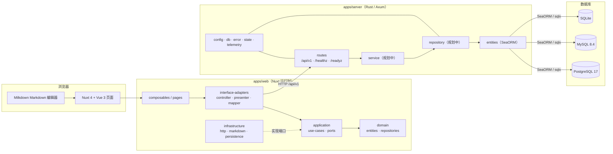
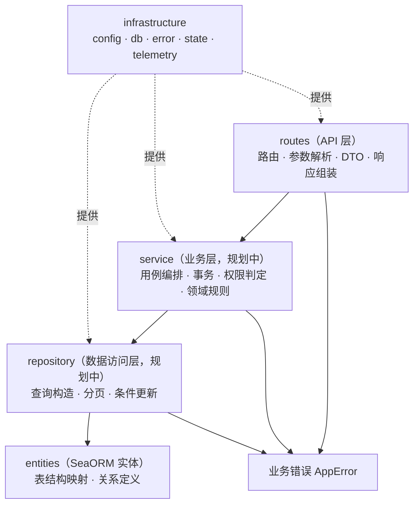
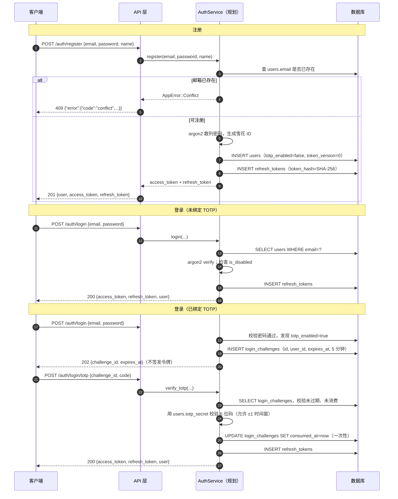
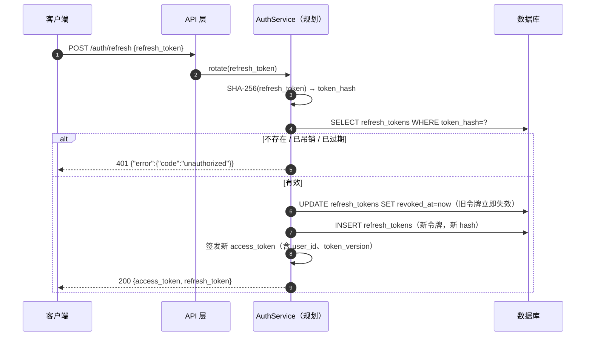
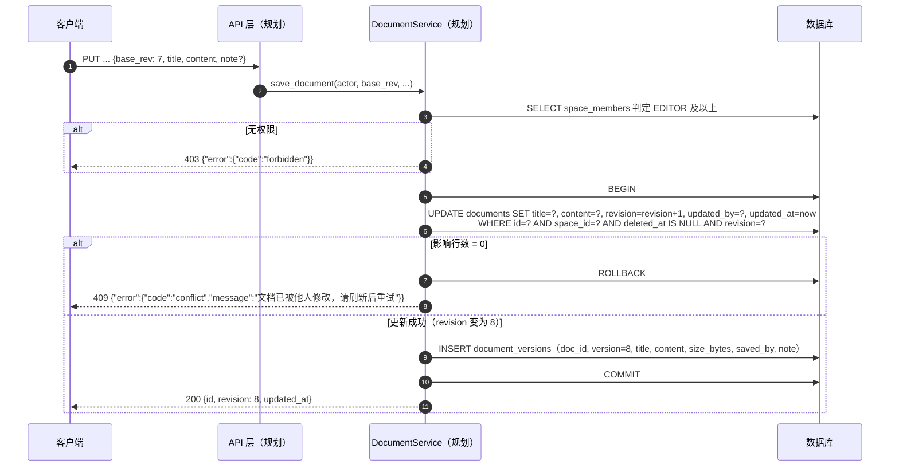
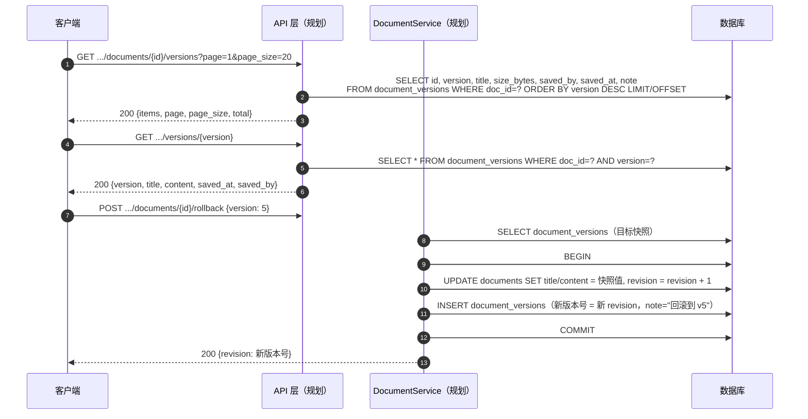
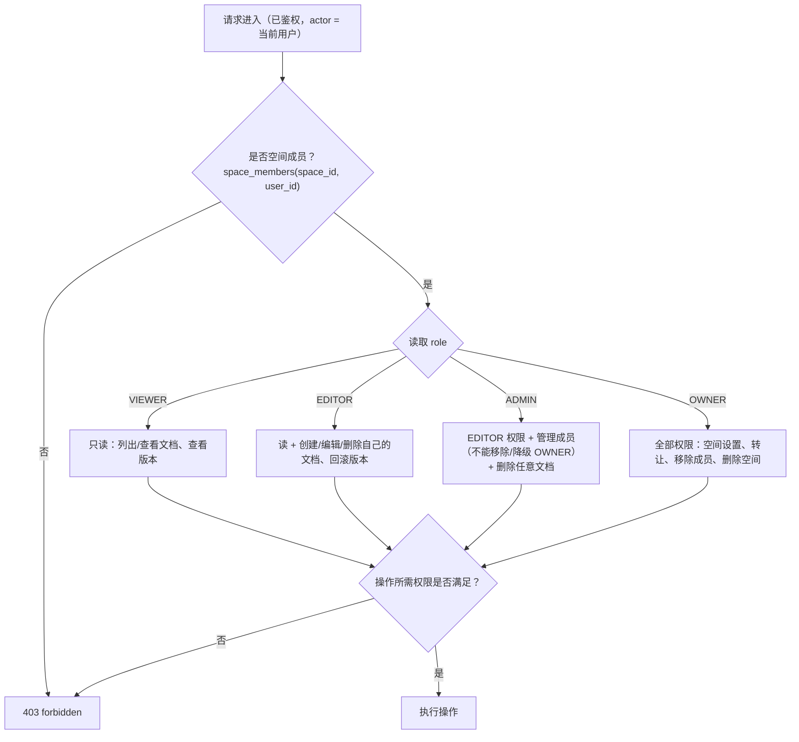
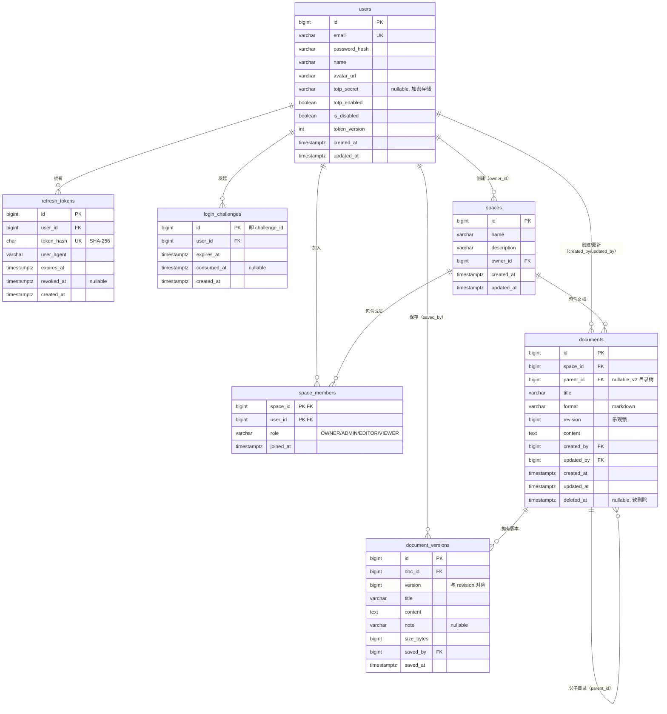
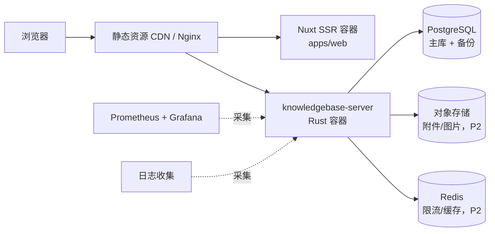

# 架构设计

本文描述「类语雀知识库」的整体架构：系统目标、后端分层、关键流程、数据模型、多数据库策略、横切关注点和演进路线。

> **当前阶段说明**：仓库处于**后端骨架阶段**。已实现：Rust workspace、配置加载、多数据库连接、迁移、统一错误模型、请求 ID / 日志 / 超时 / CORS 中间件、健康检查、7 张表的迁移与 SeaORM 实体。业务接口（认证、空间、文档、版本、搜索）在本文与 [`api.md`](api.md) 中标注为「规划中」。请以源码为最终事实来源。

## 目录

- [目标与非目标](#目标与非目标)
- [能力矩阵](#能力矩阵)
- [系统总览](#系统总览)
- [后端分层架构](#后端分层架构)
- [关键流程](#关键流程)
- [数据模型](#数据模型)
- [多数据库策略](#多数据库策略)
- [横切关注点](#横切关注点)
- [非功能设计](#非功能设计)
- [演进路线图](#演进路线图)
- [术语表](#术语表)

## 目标与非目标

### 目标

1. **类语雀的核心体验**：空间 → 目录 → 文档 → 历史版本，Markdown 所见即所得，权限按空间粒度控制。
2. **多人协作可用**：同一文档多人编辑不互相覆盖（乐观锁 + 版本快照），编辑冲突有明确提示。
3. **面向新人的工程样板**：目录边界清晰、注释中文、文档与代码同步，Rust 初学者能读懂并上手修改。
4. **部署简单**：一个二进制 + 一个数据库即可运行；本地可用 Docker 或 SQLite 零依赖启动。
5. **数据库可迁移**：同一份代码支持 PostgreSQL / MySQL / SQLite，不绑定云厂商。

### 非目标（当前阶段明确不做）

| 非目标 | 原因 / 后续安排 |
| --- | --- |
| 实时协同编辑（CRDT / OT） | 复杂度高，P2 再评估；当前用乐观锁保证不丢数据 |
| 富文本 / 块编辑器 | v1 固定 Markdown（`documents.format = markdown`） |
| 多租户 SaaS 计费 | 社团内部使用，单组织部署 |
| 微服务拆分 | 单体足够；除非出现独立扩容需求 |
| 全文搜索引擎（Elasticsearch 等） | 先做数据库 `LIKE` / 分词方案，够用再升级 |
| 移动端 App | 响应式 Web 优先 |
| 完整 CD 流水线 | 当前只有 CI，部署拓扑在「非功能设计」中给出规划 |

## 能力矩阵

优先级：**P0**＝骨架必须有的核心闭环；**P1**＝体验完整所必需；**P2**＝锦上添花。

| 能力 | 说明 | 优先级 | 当前状态 |
| --- | --- | --- | --- |
| 用户注册 / 登录 | 邮箱 + 密码，argon2 散列 | P0 | 表与实体已实现，接口规划中 |
| TOTP 两步验证 | 登录挑战（一次性 `challenge_id`），可选绑定 | P0 | 表已实现，接口规划中 |
| 刷新令牌轮换 | 只存 SHA-256，轮换时旧令牌立即吊销 | P0 | 表已实现，接口规划中 |
| 知识空间 | 空间 CRUD、按成员可见 | P0 | 表已实现，接口规划中 |
| 空间成员与角色 | `OWNER` / `ADMIN` / `EDITOR` / `VIEWER` | P0 | 表已实现（含 CHECK 约束），接口规划中 |
| 文档 CRUD | Markdown 全量内容，同空间标题唯一 | P0 | 表已实现，接口规划中 |
| 历史版本 | 每次保存生成快照，可查看与回滚 | P0 | 表已实现，接口规划中 |
| 乐观锁保存 | `documents.revision` 递增，冲突返回 409 | P0 | 字段已实现，接口规划中 |
| 健康检查 | `/healthz`、`/readyz` | P0 | **已实现** |
| 回收站（软删除） | `deleted_at`，保留 30 天后清理 | P1 | 字段已实现，清理任务规划中 |
| 目录树 | `documents.parent_id` 自关联 | P1 | 字段预留，接口规划中 |
| 搜索 | 标题 / 内容关键词 | P1 | 规划中 |
| 评论 | 文档内评论与回复 | P2 | 规划中 |
| 实时协作 | 多人同时编辑、光标同步 | P2 | 规划中 |
| 附件 / 图片上传 | 对象存储 | P2 | 规划中 |
| 通知中心 | 成员变更、文档更新提醒 | P2 | 规划中 |
| 审计日志 | 谁在什么时候改了什么 | P2 | 规划中 |
| 限流 | 登录/注册防爆破 | P1 | 规划中 |

## 系统总览



要点：

- 前端沿用既有 Clean Architecture 四层（详见 [`apps/web/docs/architecture/clean-architecture.md`](../apps/web/docs/architecture/clean-architecture.md)），后端采用对应的「api → service → repository → entity」分层。
- 前后端通过 HTTP JSON 通信，接口统一挂在 `/api/v1` 下；健康检查不带版本前缀，便于网关直接探测。
- 数据库方言由 `DATABASE_URL` 的 scheme 决定，代码不感知具体数据库。

## 后端分层架构

### 分层与职责



| 层 | 目录 | 职责 | 禁止 |
| --- | --- | --- | --- |
| API 层 | `apps/server/src/routes/` | 解析请求、校验入参、调用 service、组装 DTO 响应、映射错误 | 写 SQL、写业务规则、直接返回实体 |
| 业务层（规划中） | `apps/server/src/service/` | 用例编排、事务边界、权限判定、乐观锁重试 | 感知 HTTP 类型、直接拼 SQL |
| 数据访问层（规划中） | `apps/server/src/repository/` | 查询条件、分页、条件更新（`WHERE revision = ?`） | 做权限判断、返回 HTTP 错误 |
| 实体层 | `apps/server/src/entities/` | 与迁移表一一对应，只描述结构 | 业务逻辑、外部 IO |
| 基础设施 | `config` / `db` / `error` / `state` / `telemetry` | 配置、连接池、错误模型、共享状态、日志 | 依赖业务模块 |

依赖方向只能自上而下：`routes → service → repository → entities`。基础设施可被任意层使用，但基础设施不得反向依赖业务层。

### 目录现状

```text
apps/server/src/
├── main.rs          # 入口：dotenvy 加载 .env → AppConfig → run()
├── lib.rs           # 启动流程：日志 → 连库 → 迁移 → 监听 → 优雅停机
├── app.rs           # Router 装配 + 中间件层（Trace / RequestId / Timeout / CORS）
├── config.rs        # 环境变量 → AppConfig
├── db.rs            # 连接池、迁移执行、内存 SQLite 判定
├── error.rs         # AppError → HTTP 状态码 + 稳定错误码
├── state.rs         # AppState { db, config }，Clone 共享
├── telemetry.rs     # tracing_subscriber 初始化
├── routes/
│   ├── mod.rs       # /api/v1 路由挂载 + 统一 404
│   └── health.rs    # /healthz、/readyz
└── entities/        # 7 张表的 SeaORM 实体
```

规划中新增的目录：`service/`、`repository/`、`routes/auth.rs`、`routes/spaces.rs`、`routes/documents.rs`。新增模块时在 `routes/mod.rs` 的 `api_router()` 中挂载。

### 为什么这样分

- **API 层薄**：同一套业务可能被 HTTP、CLI、后台任务复用，业务规则不应该和 `axum::Json` 绑死。
- **service 管事务**：一次「保存文档」包含更新 `documents` + 插入 `document_versions`，必须在同一事务内完成，事务边界属于业务层。
- **repository 管方言**：三种数据库的差异（部分索引、`RETURNING`、`ON CONFLICT`）集中在数据访问层，service 只表达意图。
- **实体只映射结构**：SeaORM `Model` 是数据库记录的镜像，不直接暴露给前端，避免字段泄漏和耦合。

## 关键流程

以下时序图描述的是**目标设计**（认证、文档、权限接口均为规划中），其中涉及的表结构已由迁移实现。图中标注「已实现」的组件是当前代码可运行的。

### 注册 / 登录（含 TOTP 登录挑战）



设计要点：

- 登录挑战在数据库中只有 `id`、`user_id`、`expires_at`、`consumed_at`，**一次性**且**短时有效**；验证失败不签发任何令牌。
- `users.is_disabled` 为 `true` 时拒绝登录，已签发的访问令牌也应在鉴权中间件中失效。
- TOTP 密钥 `users.totp_secret` 由应用层加密后存储（明文绝不落库），加密密钥来自独立环境变量（规划中，见 [`development.md`](development.md)）。
- 密码只存 argon2 编码串，比较使用恒定时间校验。

### 刷新令牌轮换



安全策略：

- 数据库**只存 refresh token 的 SHA-256 十六进制摘要**（`token_hash` 唯一索引），泄露数据库也无法直接使用令牌。
- 每次刷新都**吊销旧令牌并签发新令牌**（rotation）；旧令牌再次使用视为重放，可撤销该用户全部令牌（P1 增强）。
- 访问令牌携带 `token_version`，与 `users.token_version` 比对；用户改密码时 `token_version + 1`，此前所有访问令牌立即失效。
- 登出 = 吊销当前 refresh token（`revoked_at = now`）；「登出所有设备」= 吊销该用户全部 refresh token。

### 文档保存与乐观锁



设计要点：

- **条件更新是乐观锁的核心**：`WHERE revision = ?` 与 `revision = revision + 1` 在一条 SQL 内完成，影响行数为 0 即版本冲突，返回 `409 conflict`。
- 冲突不自动合并（v1）：前端提示「文档已更新」并提供两个选择——重新加载（丢弃本地）或另存为新版本（P1）。
- 快照与正文更新在**同一事务**，保证「有正文必有对应版本」。
- 前端用 `base_rev`（即加载时的 `revision`）提交；也接受 HTTP `If-Match: "<revision>"` 形式，两者语义一致（规划中，见 [`api.md`](api.md)）。
- `size_bytes` 存内容 UTF-8 字节数，供版本列表展示，避免列表接口读取 `content` 大字段。

### 历史版本快照与回滚



设计要点：

- **回滚不覆盖历史**：回滚会生成一个新版本（`version = 当前 revision + 1`），原来的 v5 以及被回滚掉的内容都仍在版本列表里，随时可以再回滚回去。
- `uniq_document_versions_doc_version` 唯一索引保证同一文档的版本号不重复。
- 版本列表接口不返回 `content`，避免大字段拖慢分页；详情接口才返回全文。
- 版本保留策略：P1 计划「每个文档保留最近 N 个版本 + 每天保留一个自动快照」，由后台任务清理。

### 权限判定



角色矩阵：

| 操作 | OWNER | ADMIN | EDITOR | VIEWER |
| --- | --- | --- | --- | --- |
| 查看空间 / 文档 / 版本 | ✅ | ✅ | ✅ | ✅ |
| 创建 / 编辑文档 | ✅ | ✅ | ✅ | ❌ |
| 删除文档（进回收站） | ✅ | ✅ | ✅（自己的） | ❌ |
| 回滚版本 | ✅ | ✅ | ✅ | ❌ |
| 管理成员（增删改角色） | ✅ | ✅（不能动 OWNER） | ❌ | ❌ |
| 修改空间设置 / 转让 / 删除空间 | ✅ | ❌ | ❌ | ❌ |

实现约定：

- 权限判定**只在服务端**执行，前端隐藏按钮只是体验优化，不构成安全边界。
- 每个空间在创建时自动写入一条 `space_members(role = 'OWNER')`，与 `spaces.owner_id` 保持一致。
- 判定结果需要「拒绝原因」时区分 `401 unauthorized`（未登录/令牌失效）与 `403 forbidden`（已登录但无权限）。

## 数据模型

### ER 关系



### 通用约定

- **主键**：统一 `bigint`，由**应用层生成雪花 ID**，`auto_increment = false`。理由：分布式与多数据库下不依赖自增序列；ID 本身不暴露业务量。
- **时间**：统一 `timestamp_with_time_zone`（SeaORM `DateTimeWithTimeZone`），默认 `CURRENT_TIMESTAMP`；接口输出 RFC 3339（见 [`api.md`](api.md)）。
- **布尔**：`is_disabled`、`totp_enabled` 等使用数据库布尔类型，默认 `false`。
- **字符串长度**：邮箱 255、昵称 32、标题 255、角色 16、`token_hash` 64。业务层还需做二次校验，不依赖数据库长度约束。
- **软删除**：仅 `documents.deleted_at`；其余表物理删除（外键 `ON DELETE CASCADE` 或 `RESTRICT` 视业务而定）。

### 表说明

#### 1. `users` — 用户账号

| 字段 | 类型 | 约束 | 说明 |
| --- | --- | --- | --- |
| `id` | bigint | PK | 雪花 ID |
| `email` | varchar(255) | NOT NULL, UNIQUE | 登录邮箱，全局唯一 |
| `password_hash` | varchar(255) | NOT NULL | argon2 编码串 |
| `name` | varchar(32) | NOT NULL | 昵称 |
| `avatar_url` | varchar(512) | NOT NULL, DEFAULT `''` | 头像地址 |
| `totp_secret` | varchar(255) | NULL | TOTP 密钥，应用层加密存储 |
| `totp_enabled` | boolean | NOT NULL, DEFAULT false | 是否启用两步验证 |
| `is_disabled` | boolean | NOT NULL, DEFAULT false | 封禁标记 |
| `token_version` | int | NOT NULL, DEFAULT 0 | 改密码时 +1，使旧令牌失效 |
| `created_at` / `updated_at` | timestamptz | NOT NULL | 创建 / 更新时间 |

索引：`email` 唯一索引（由 `unique_key` 生成）。

#### 2. `refresh_tokens` — 刷新令牌

| 字段 | 类型 | 约束 | 说明 |
| --- | --- | --- | --- |
| `id` | bigint | PK | 雪花 ID |
| `user_id` | bigint | NOT NULL, FK → users.id, ON DELETE CASCADE | 所属用户 |
| `token_hash` | varchar(64) | NOT NULL, UNIQUE | 令牌 SHA-256 十六进制，不存明文 |
| `user_agent` | varchar(255) | NULL | 客户端 UA，用于设备列表 |
| `expires_at` | timestamptz | NOT NULL | 过期时间 |
| `revoked_at` | timestamptz | NULL | 吊销时间，非空即失效 |
| `created_at` | timestamptz | NOT NULL | 签发时间 |

索引：`token_hash` 唯一约束（迁移中的 `unique_key` 生成）、`idx_refresh_tokens_user_id`（查用户所有设备）。

#### 3. `login_challenges` — TOTP 登录挑战

| 字段 | 类型 | 约束 | 说明 |
| --- | --- | --- | --- |
| `id` | bigint | PK | 即接口中的 `challenge_id` |
| `user_id` | bigint | NOT NULL, FK → users.id, ON DELETE CASCADE | 发起挑战的用户 |
| `expires_at` | timestamptz | NOT NULL | 过期时间（建议 5 分钟） |
| `consumed_at` | timestamptz | NULL | 消费时间，一次性使用 |
| `created_at` | timestamptz | NOT NULL | 创建时间 |

索引：`idx_login_challenges_user_id`。过期记录由后台任务清理（规划中）。

#### 4. `spaces` — 知识空间

| 字段 | 类型 | 约束 | 说明 |
| --- | --- | --- | --- |
| `id` | bigint | PK | 雪花 ID |
| `name` | varchar(128) | NOT NULL | 空间名称 |
| `description` | varchar(1024) | NOT NULL, DEFAULT `''` | 空间简介 |
| `owner_id` | bigint | NOT NULL, FK → users.id | 创建者（拥有者） |
| `created_at` / `updated_at` | timestamptz | NOT NULL | 时间戳 |

#### 5. `space_members` — 空间成员

| 字段 | 类型 | 约束 | 说明 |
| --- | --- | --- | --- |
| `space_id` | bigint | PK, FK → spaces.id, ON DELETE CASCADE | 空间 |
| `user_id` | bigint | PK, FK → users.id, ON DELETE CASCADE | 用户 |
| `role` | varchar(16) | NOT NULL, CHECK IN ('OWNER','ADMIN','EDITOR','VIEWER') | 角色 |
| `joined_at` | timestamptz | NOT NULL | 加入时间 |

联合主键 `(space_id, user_id)` 保证同一用户在同一空间只有一条记录；`idx_space_members_user_id` 支持「我加入的空间」列表。

#### 6. `documents` — 文档

| 字段 | 类型 | 约束 | 说明 |
| --- | --- | --- | --- |
| `id` | bigint | PK | 雪花 ID |
| `space_id` | bigint | NOT NULL, FK → spaces.id, ON DELETE CASCADE | 所属空间 |
| `parent_id` | bigint | NULL, FK → documents.id | 父文档，v1 全部为 NULL（根目录平铺），v2 目录树 |
| `title` | varchar(255) | NOT NULL | 标题，同空间活跃文档唯一 |
| `format` | varchar(16) | NOT NULL, DEFAULT `'markdown'` | 内容格式 |
| `revision` | bigint | NOT NULL, DEFAULT 0 | 内容版本号，乐观锁比较对象 |
| `content` | text | NOT NULL, DEFAULT `''` | 当前全量 Markdown |
| `created_by` / `updated_by` | bigint | NOT NULL, FK → users.id | 创建者 / 最后更新者 |
| `created_at` / `updated_at` | timestamptz | NOT NULL | 时间戳 |
| `deleted_at` | timestamptz | NULL | 软删除；非空即在回收站，保留 30 天 |

索引：

- `idx_documents_space_id_deleted_at (space_id, deleted_at)`：空间文档列表（排除回收站）。
- `uniq_documents_space_title_active (space_id, title) WHERE deleted_at IS NULL`：同空间活跃标题唯一，回收站中的文档不占位。
- 外键：`space_id`（CASCADE）、`parent_id`（自关联）、`created_by`、`updated_by`。

#### 7. `document_versions` — 文档历史版本

| 字段 | 类型 | 约束 | 说明 |
| --- | --- | --- | --- |
| `id` | bigint | PK | 雪花 ID |
| `doc_id` | bigint | NOT NULL, FK → documents.id, ON DELETE CASCADE | 所属文档 |
| `version` | bigint | NOT NULL | 与 `documents.revision` 对应 |
| `title` | varchar(255) | NOT NULL | 快照标题 |
| `content` | text | NOT NULL | 快照全文 |
| `note` | varchar(255) | NULL | 保存备注，可选 |
| `size_bytes` | bigint | NOT NULL | 内容字节数，列表展示用 |
| `saved_by` | bigint | NOT NULL, FK → users.id | 保存人 |
| `saved_at` | timestamptz | NOT NULL | 保存时间 |

索引：`uniq_document_versions_doc_version (doc_id, version)` 唯一，保证版本号不重复。

## 多数据库策略

### 为什么同时支持三种

| 数据库 | 定位 | 理由 |
| --- | --- | --- |
| PostgreSQL | 生产首选 | 功能完整、部分索引 / JSONB / 全文检索能力强，Docker 一键启动 |
| MySQL | 兼容选项 | 校园/云环境常见，学生免费额度多；验证 SEAORM 方言可移植性 |
| SQLite | 本地开发 / 测试 | 零依赖、单文件、内存库跑测试快；降低新人上手门槛 |

同一份代码通过 `DATABASE_URL` 的 scheme 自动选择方言（`db::connect`），迁移与实体只写一份。

### 方言兼容规则

| 问题 | 规则 / 现状 |
| --- | --- |
| 自增主键 | **不使用**。应用层生成雪花 ID，`auto_increment = false` |
| 时间类型 | 统一 `timestamp_with_time_zone`；MySQL 侧由 SeaORM 映射，注意不能依赖 `now()` 之外的方言函数 |
| 布尔类型 | 使用逻辑布尔，不手写 `TINYINT(1)` 判断 |
| 部分唯一索引 | PostgreSQL / SQLite 用部分索引；MySQL 用 STORED 生成列 + 唯一索引。迁移按 `manager.get_database_backend()` 分支生成 SQL（见下） |
| `CHECK` 约束 | MySQL 8.0.16+ 与 SQLite 均支持；旧版本 MySQL 会忽略，因此业务层仍需校验角色取值 |
| 大小写敏感 | 邮箱查询在业务层统一 `lower(email)` 后比较，避免数据库排序规则差异（规划中） |
| 事务与隔离级别 | 只用默认隔离级别 + 条件更新，不依赖数据库特有的 `LOCK IN SHARE MODE` 语法 |

### 方言差异的落地方式：以「活跃文档标题唯一」为例

需求是「同一空间内**活跃**文档标题唯一，回收站中的文档不占位」。不同数据库的支持能力不同，`crates/migration/src/m20261008_000006_create_documents.rs` 用 `match manager.get_database_backend()` 分支处理：

**PostgreSQL / SQLite：部分唯一索引**

```sql
CREATE UNIQUE INDEX uniq_documents_space_title_active
ON documents (space_id, title) WHERE deleted_at IS NULL
```

索引只覆盖 `deleted_at IS NULL` 的行，天然忽略回收站文档。

**MySQL：STORED 生成列 + 唯一索引**

MySQL 不支持部分索引，改为新增生成列：活跃文档取 `title`，回收站文档取 `NULL`，再对 `(space_id, active_title)` 建唯一索引：

```sql
ALTER TABLE documents
  ADD COLUMN active_title VARCHAR(255)
  GENERATED ALWAYS AS (CASE WHEN deleted_at IS NULL THEN title ELSE NULL END) STORED;
CREATE UNIQUE INDEX uniq_documents_space_title_active
  ON documents (space_id, active_title);
```

MySQL 的唯一索引允许多个 `NULL`，因此回收站中的重名文档不会互相冲突，语义与部分索引一致。

**其他后端**：直接返回 `DbErr::Migration`，明确报错而不是静默降级。

这个方案带来的注意点：

- `active_title` 是数据库侧的派生列，SeaORM 实体里**不定义**它（实体查询按列名显式选择，不受影响）；写数据时也不能直接赋值。
- 未来若要彻底移除该列，需要成对修改 `up` / `down` 或新增迁移。
- **排序规则差异**：`docker-compose.yml` 中 MySQL 使用 `utf8mb4_unicode_ci`（大小写不敏感），PostgreSQL 默认大小写敏感。因此 `Title` 与 `title` 在 MySQL 上会判定为重复、在 PostgreSQL 上不会。业务层如需要统一语义，应在写入前做大小写归一化（P2 规划）。
- 迁移代码中的原生 SQL 是**唯一允许的字符串 SQL**（DDL 无参数化 API），其余查询必须使用 SeaORM / sqlx 参数化。

### 测试矩阵（规划中）

| 场景 | PostgreSQL | MySQL | SQLite |
| --- | --- | --- | --- |
| 迁移 `up` / `down` | CI 容器 | CI 容器（profile） | 本地 + CI 内存库 |
| repository 集成测试 | CI 容器 | CI 容器 | 默认 |
| 单元测试 | — | — | `sqlite::memory:`（最快） |

## 横切关注点

### 错误模型

统一错误类型 `AppError`（`apps/server/src/error.rs`），响应格式固定：

```json
{
  "error": {
    "code": "not_found",
    "message": "文档不存在"
  }
}
```

| 变体 | HTTP | `code` | 使用场景 |
| --- | --- | --- | --- |
| `BadRequest` | 400 | `bad_request` | 参数缺失、格式非法 |
| `Unauthorized` | 401 | `unauthorized` | 未登录、令牌过期/失效 |
| `Forbidden` | 403 | `forbidden` | 已登录但无权限 |
| `NotFound` | 404 | `not_found` | 资源不存在；路由不匹配时也返回该结构 |
| `Conflict` | 409 | `conflict` | 标题重名、乐观锁版本冲突 |
| `Internal` | 500 | `internal_error` | 内部错误，`message` 固定为「服务器内部错误」，细节只写日志 |

约定：客户端应基于 `code` 做分支判断，`message` 仅用于展示；新增错误码必须同步更新 [`api.md`](api.md)。

### 请求 ID、日志与 tracing

- 中间件顺序（由外到内）：CORS → Timeout → RequestId（`SetRequestIdLayer`）→ Trace → 业务路由。
- `x-request-id`：客户端可传入，缺失时自动生成 UUID；响应头回传，日志的 span 中携带，便于全链路排查。
- `TraceLayer::new_for_http()` 为每个请求生成 span 并记录方法、路径、状态码、耗时。
- 日志初始化在 `telemetry::init(&config.log_filter)`，支持 `RUST_LOG` 过滤表达式。
- `db::connect()` 会打印后端类型（`Postgres` / `MySql` / `Sqlite`）与是否内存库。

### 配置

所有配置来自环境变量（`config.rs`），启动时一次性校验，非法值直接失败并提示具体变量名。`AppState` 持有 `AppConfig` 的克隆，handler 通过 `State<AppState>` 访问。完整变量表见 [`development.md`](development.md#环境变量)。

### 健康检查

| 接口 | 行为 | 成功 | 失败 |
| --- | --- | --- | --- |
| `GET /healthz` | 不访问数据库，固定返回 | `200 {"status":"ok","service":"knowledgebase-server","version":"0.1.0"}` | — |
| `GET /readyz` | `db.ping()` | `200 {"status":"ready","database":"up"}` | `503 {"status":"degraded","database":"down"}` |

部署约定：存活探针用 `/healthz`，就绪探针用 `/readyz`；`/readyz` 失败时网关不应把流量转发到该实例。

### CORS

- `APP_CORS_ORIGINS` 为空 → 允许任意来源（仅建议本地开发）。
- 配置后按逗号分隔白名单放行，允许方法 `GET/POST/PUT/PATCH/DELETE/OPTIONS`，允许头 `Accept/Authorization/Content-Type/Origin/x-request-id`，暴露 `x-request-id`。
- 生产环境必须显式配置，禁止留空。

### 超时

`APP_REQUEST_TIMEOUT_SECS`（默认 30 秒）由 `TimeoutLayer::with_status_code` 强制，超时统一返回 `408 Request Timeout`。长耗时任务（导出、批量迁移）应拆到后台任务，不要占用请求超时预算。

### 鉴权（规划中）

- 访问令牌：JWT（HS256 或 EdDSA，密钥来自环境变量），短有效期（建议 15 分钟），载荷含 `sub`（用户 ID）、`tv`（token_version）、`exp`。
- 刷新令牌：随机 256 位，SHA-256 后入库，长有效期（建议 30 天），每次刷新轮换。
- 鉴权中间件在 `routes` 之前提取 `Authorization: Bearer <token>`，校验签名、过期时间、`users.is_disabled`、`users.token_version`。
- 密码重置：通过邮箱验证码或管理员重置，重置后 `token_version + 1` 并吊销全部 refresh token。

### 限流（规划中）

- 登录 / 注册 / TOTP 校验按 IP + 邮箱维度限流，例如每分钟 5 次，超过返回 `429`。
- 写操作按用户维度限流，防止脚本刷文档。
- 实现方式优先使用内存滑动窗口（`tower-governor` 或自研中间件），多实例部署时迁移到 Redis（P2）。

## 非功能设计

### 性能

| 关注点 | 设计 |
| --- | --- |
| 列表查询 | 空间文档列表走 `(space_id, deleted_at)` 索引；版本列表走 `(doc_id, version)` 唯一索引 |
| 大字段 | `content` 只在详情/保存接口读取；列表与版本列表不返回全文 |
| 分页 | 统一 `page` / `page_size`（默认 20，最大 100），返回 `total`；深分页可改用游标（P2） |
| 连接池 | 默认最大 10 连接、连接/获取超时 10 秒；内存 SQLite 固定 1 连接 |
| 乐观锁 | 单条条件 UPDATE，无悲观锁、无长事务 |
| 版本膨胀 | P1 引入版本保留策略（最近 N 个 + 每日快照）与归档清理 |
| 未来 | 读多写少后加缓存（空间信息、成员权限），注意「改密码/移出成员」时的缓存失效 |

### 安全

| 风险 | 措施 |
| --- | --- |
| 密码泄露 | argon2 加盐散列，永不记录明文；`password_hash` 不进入任何 API 响应 |
| 令牌泄露 | refresh token 只存 SHA-256；访问令牌短有效期；`token_version` 支持全端下线 |
| TOTP 密钥泄露 | 应用层加密后存储（加密密钥独立于数据库，见规划） |
| 越权 | 所有空间/文档操作在 service 层查 `space_members`；不信任前端传入的角色 |
| SQL 注入 | 全部使用 SeaORM / sqlx 参数化查询；禁止字符串拼接 SQL（迁移中的 DDL 除外） |
| 信息泄露 | `internal_error` 不返回内部细节；日志中 `DATABASE_URL` 密码被 `redact_database_url` 打码 |
| CORS | 生产显式白名单 |
| 限流 / 爆破 | 登录、注册、TOTP 接口限流（规划中） |
| 软删除数据残留 | 回收站 30 天后物理删除；用户注销时按需匿名化（P2） |

### 可观测性

- **日志**：结构化 `tracing`，包含请求 ID、方法、路径、状态码、耗时；错误日志包含错误链。
- **指标**（规划中）：请求量、错误率、P95 延迟、连接池使用率、迁移状态；使用 `metrics` + Prometheus 导出。
- **追踪**（规划中）：当前是单服务 span；未来接入 OpenTelemetry，把 HTTP → service → SQL 串成完整 trace。
- **审计**（规划中）：文档保存、成员变更、登录事件写入审计表，满足社团事后追溯需求。

### 部署拓扑（规划中）



部署形态建议：

- 单机模式：`docker compose` 同时跑 `web` + `server` + `postgres`，适合社团初期。
- 小规模集群：server 无状态，可水平扩展；迁移在发布阶段由单独 Job 执行（`APP_RUN_MIGRATIONS=false`）。
- 发布顺序：先迁移后启动新版本；迁移保持向后兼容（先加列不删列，下一版本再清理）。

## 演进路线图

### P0：核心闭环（当前阶段）

- [x] Rust virtual workspace、pnpm workspace monorepo 骨架
- [x] 配置加载、多数据库连接池、迁移执行、统一错误模型、日志、请求 ID、超时、CORS、健康检查
- [x] 7 张表迁移 + SeaORM 实体
- [x] 三种数据库方言兼容（MySQL 部分唯一索引用生成列替代）
- [ ] 认证：注册、登录、TOTP 登录挑战、刷新令牌轮换、登出
- [ ] 空间：CRUD、成员管理、角色判定
- [ ] 文档：CRUD、乐观锁保存、软删除（回收站）
- [ ] 历史版本：保存快照、列表、详情、回滚
- [ ] 接口文档与前端联调

### P1：体验完整

- [ ] 搜索（标题 + 内容，数据库 `LIKE` / 全文索引）
- [ ] 目录树（`parent_id` 真正启用，拖拽排序）
- [ ] 回收站自动清理任务（30 天）
- [ ] 版本保留策略与清理

- [ ] 限流、审计日志
- [ ] 前端编辑器与后端联调、自动保存

### P2：协作与规模化

- [ ] 实时协作编辑（CRDT，Yjs / Automerge 评估）
- [ ] 评论与通知
- [ ] 附件 / 图片上传（对象存储）
- [ ] 全文搜索引擎
- [ ] 可观测性完善（Prometheus / OpenTelemetry）
- [ ] 多实例部署与 Redis 限流 / 缓存
- [ ] 导入导出（Markdown / 语雀格式迁移）

## 术语表

| 术语 | 含义 |
| --- | --- |
| 空间（Space） | 知识的顶层容器，类似语雀的「知识库」，成员与权限以空间为单位 |
| 文档（Document） | 空间内的一篇 Markdown 内容，有标题、正文、版本号 |
| 版本（Version） | 一次保存生成的不可变快照，`document_versions.version` 与 `documents.revision` 对应 |
| revision | 文档内容版本号，每次保存 +1，用于乐观锁 |
| base_rev | 客户端提交保存时携带的「我基于哪个版本修改」，用于冲突检测 |
| 乐观锁 | 通过「条件更新 + 版本号」避免并发覆盖，不锁行 |
| 软删除 | 只写 `deleted_at` 不物理删除，进入回收站 |
| 雪花 ID | 应用层生成的 64 位有序唯一 ID，不依赖数据库自增 |
| TOTP | 基于时间的一次性密码（两步验证） |
| Refresh Token Rotation | 每次刷新都吊销旧令牌并签发新令牌 |
| OWNER / ADMIN / EDITOR / VIEWER | 空间四级角色，权限由高到低 |

## 相关文档

- 接口规范：[`api.md`](api.md)
- 开发指南：[`development.md`](development.md)
- 架构决策：[`adr/0001-monorepo-and-tech-stack.md`](adr/0001-monorepo-and-tech-stack.md)
- 前端架构：[`apps/web/docs/architecture/clean-architecture.md`](../apps/web/docs/architecture/clean-architecture.md)
- 贡献流程：[`CONTRIBUTING.md`](../CONTRIBUTING.md)
